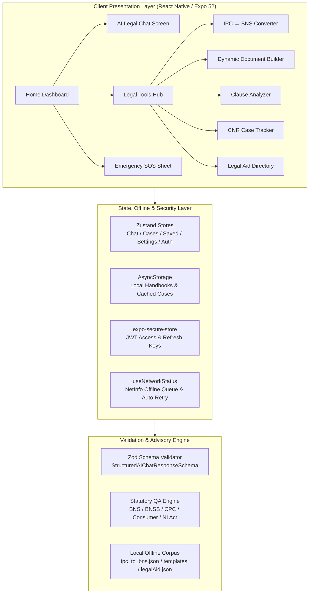

# LawGPT – India's AI Legal Assistant

[](https://www.typescriptlang.org/)
[](https://reactnative.dev/)
[](https://expo.dev/)
[](https://android.com)
[]()
[]()

> Sovereign, accessible, and verified legal guidance for Indian citizens and advocates. Powered by the 2023–2024 criminal law transition (Bharatiya Nyaya Sanhita, Bharatiya Nagarik Suraksha Sanhita, Bharatiya Sakshya Adhiniyam).

---

## 1. Problem Statement

India faces a significant legal access bottleneck:
- **Over 45 Million Pending Cases:** Citizens frequently struggle to navigate pre-trial procedural hurdles, police encounters, and civil disputes.
- **Historic Criminal Law Overhaul:** On 1 July 2024, India replaced the colonial Indian Penal Code (1860), Code of Criminal Procedure (1973), and Indian Evidence Act (1872) with **BNS 2023**, **BNSS 2023**, and **BSA 2023**. Citizens and lawyers urgently need instant cross-mapping between old and new statutes.
- **Language & Literacy Barriers:** Legal terminology is predominantly English and complex legalese. Citizens need vernacular explanations in Hindi (हिंदी) and Marathi (मराठी) without losing statutory accuracy.
- **Financial & Geopolitical Vulnerabilities:** Unverified online advice causes procedural forfeiture. LawGPT bridges this by providing grounded statutory intelligence, offline emergency toolkits, and pro bono legal aid directories.

---

## 2. Architecture Overview



---

## 3. Key Capabilities

- **BNS ↔ IPC Instant Cross-Converter:** Search by section number, keyword, or offense type (e.g. IPC 420 ↔ Section 318(4) BNS).
- **Structured Statutory AI Advisory:** Every response provides an executive summary, relevant bare act sections, procedural step-by-step guidance, actionable options, landmark citations, and statutory disclaimers.
- **Offline-First Resilience:** Emergency SOS helplines (112, 1930, 1091, 15100), Know Your Rights, legal glossaries, and case diaries function completely offline. Outgoing chat questions automatically queue when disconnected and auto-retry upon reconnect.
- **Dynamic Legal Document Builder:** Generate A4 Court-ready drafts (Bail Application, RTI, Legal Notice, Rental Agreement, Affidavit, Consumer Complaint) with Noto Sans Devanagari typography, watermarks, and PDF sharing via `expo-print`.
- **Pre-Litigation Clause Analyzer:** Upload contracts (PDF/Images) under 10 MB for extraction of lock-in periods, unilateral termination risks, and jurisdictional covenants.
- **Multilingual Support (en, hi, mr):** Seamless real-time language switching across English, Hindi, and Marathi with deep key parity.
- **Role-Gated Navigation:** Tailored workflows for Citizens, Practicing Advocates (Bar Council verification), and Admins.

---

## 4. Setup & Running Locally

### Prerequisites
- Node.js 18.x or 20.x
- Java Development Kit (JDK) 17
- Android Studio (with Android SDK Platform 34 / 35 and Build-Tools)
- PowerShell (Windows) or Terminal (macOS/Linux)

### Installation
```bash
# Clone repository
git clone https://github.com/your-org/lawgpt-app.git
cd lawgptapp

# Install dependencies
npm install
```

### Environment Variables
Configure your environment in `.env` (or pass via shell):
```env
EXPO_PUBLIC_API_MODE=mock       # "mock" for offline deterministic fixtures, "live" for production backend
EXPO_PUBLIC_API_URL=https://api.lawgpt.in/v1
EXPO_PUBLIC_REQUEST_TIMEOUT_MS=15000
```

### Running the App
```bash
# Start Expo Metro bundler
npm start

# Run directly on connected Android device or emulator
npm run android

# Run on iOS simulator (macOS only)
npm run ios

# Run web preview
npm run web
```

---

## 5. Verification & Test Suite

The codebase enforces strict TypeScript typechecking and automated Jest regression suites:

```bash
# Run full Jest test suite (8 suites, 56 tests)
npm test

# Run strict TypeScript compiler verification (0 errors)
npm run typecheck

# Run 50-Question Statutory QA Suite (100% Pass Rate)
npx ts-node scripts/run-qa.ts
```

---

## 6. Security & DPDP Act 2023 Compliance

- **Hardware-Backed Keystore:** All authentication tokens are strictly stored using `expo-secure-store` (Android Keystore / iOS Keychain), never plain `AsyncStorage`.
- **Zero Cleartext HTTP:** `android:usesCleartextTraffic="false"` is enforced at the Android OS manifest level.
- **Sanitized Citizen Errors:** Raw backend exceptions, SQL schemas, and server stack traces are masked into friendly citizen guidance via `src/api/errors.ts`.
- **Digital Personal Data Protection (DPDP) Act 2023 Compliance:**
  - One-tap complete JSON data export (`ProfileScreen`).
  - "Delete All My Data" hard purge irreversibly wipes `AsyncStorage`, `SecureStore`, and local application caches.
  - Zero analytics or tracking telemetry collected without consent.
- **Quick Exit Trigger:** Instant screen clearing pill in `ChatScreen` and triple-tap SOS safeguards privacy during sensitive domestic or police inquiries.

---

## 7. Build & Distribution Profiles (`eas.json`)

```bash
# 1. Preview APK (Direct sideloading on physical test devices)
npx eas-cli build --profile preview --platform android

# 2. Production Android App Bundle (.aab for Google Play Store)
npx eas-cli build --profile production --platform android
```
