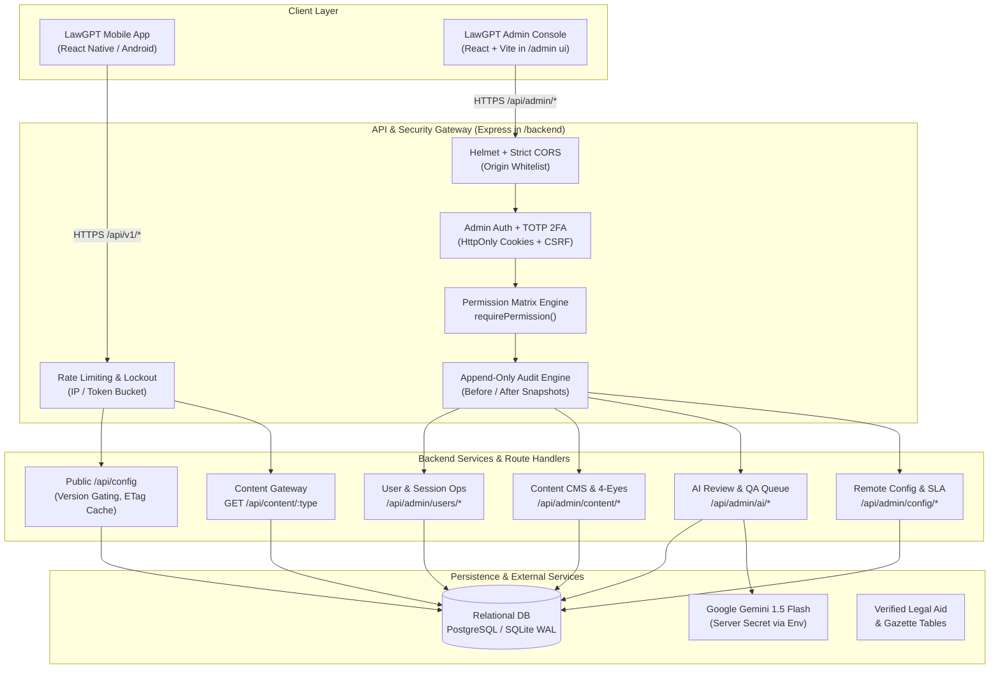
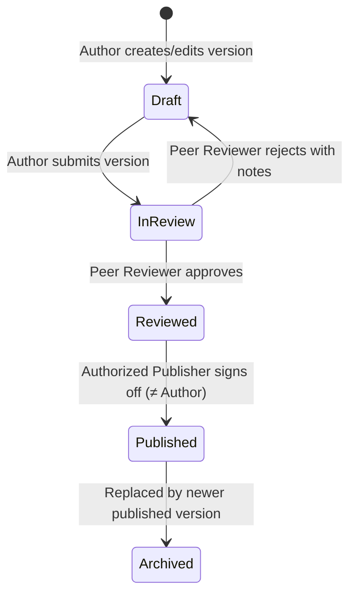
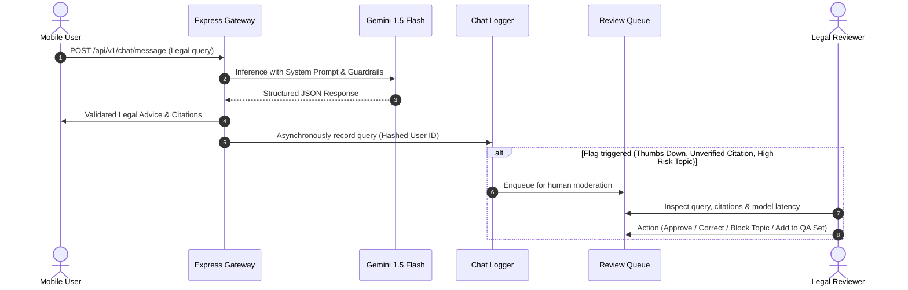

# LawGPT System Architecture & Admin Technical Blueprint

**Document:** `/docs/admin/architecture.md`  
**Phase:** Phase 0 (Planning & Architecture)  
**Author:** Senior Full-Stack & Security Engineer  

---

## 1. System Overview & Component Diagram

LawGPT operates as an integrated legal intelligence platform comprising three primary tiers:
1. **LawGPT Mobile Application (`/`):** React Native / Expo application running on user devices (Android / iOS).
2. **LawGPT Express Backend (`/backend`):** High-throughput REST & SSE API gateway handling business logic, authentication, AI orchestration, and database operations.
3. **LawGPT Web Admin Console (`/admin ui`):** Modern React + Vite web dashboard serving operations, advocates, reviewers, and platform administrators.



---

## 2. Security Architecture & Threat Model

### 2.1. Authentication & Session Lifecycles
- **Strict Partitioning:** Admin accounts exist in an isolated `admin_users` table, completely separated from citizen/advocate accounts in `users`.
- **Password Security:** Salted password hashing with `bcrypt` (work factor 12) or `argon2id`.
- **Mandatory TOTP 2FA:** RFC 6238 time-based one-time password (TOTP) verification required on all admin accounts. Upon entering correct credentials, the admin is placed in a `PENDING_2FA` state with a 5-minute pre-auth token. Only a valid TOTP token issues the final session cookies.
- **Session Tokens & Cookies:**
  - `admin_access_token`: Short-lived JWT (15-minute expiry) carried in an `HttpOnly`, `SameSite=Strict`, `Secure` cookie.
  - `admin_refresh_token`: Opaque cryptographically random token (24-hour expiry) stored as a SHA-256 hash in `admin_sessions`. Rotated on every use.
- **CSRF Defense:** Double-submit cookie pattern or custom header requirement (`X-CSRF-Token` / `X-Requested-With: LawGPT-Admin`) paired with `SameSite=Strict` cookies.
- **Brute-Force & Lockout:**
  - 5 failed attempts locks the admin account for 15 minutes.
  - Rate limiting: max 10 login requests per minute per IP.

### 2.2. Role-Based Access Control (RBAC) & Permission Engine
Client-side role checks are treated as strictly cosmetic UI hints. The server enforces permissions via a single, immutable permissions definition file:

```typescript
// /backend/src/security/permissions.ts
export type AdminRole = 'user' | 'support' | 'reviewer' | 'subadmin' | 'admin';

export const ROLE_PERMISSIONS: Record<AdminRole, string[]> = {
  user: [],
  support: [
    'users.read',
    'guest_quota.read',
    'config.read',
    'sessions.read',
  ],
  reviewer: [
    'users.read',
    'content.read',
    'content.edit_draft',
    'content.review',
    'ai.review_queue',
    'ai.qa_test',
    'feedback.read',
    'feedback.respond',
  ],
  subadmin: [
    'users.read',
    'users.suspend',
    'users.reset_quota',
    'sessions.read',
    'sessions.revoke',
    'content.read',
    'content.edit_draft',
    'content.review',
    'content.publish',
    'ai.review_queue',
    'ai.qa_test',
    'ai.prompt_edit',
    'feedback.manage',
    'directory.manage',
  ],
  admin: [
    '*', // All permissions granted
  ],
};
```

#### Middleware Enforcement:
Every `/api/admin/*` route must pass through:
```typescript
requirePermission('content.publish')
```
If the authenticated actor's role does not possess the explicit permission (or `'*'`), the server returns HTTP 403 Forbidden with a standardized, non-leaking JSON error:
`{ "error": "FORBIDDEN", "message": "Insufficient permissions for this operation" }`.

### 2.3. Append-Only Tamper-Evident Audit Logging
Every HTTP mutation (`POST`, `PUT`, `PATCH`, `DELETE`) on the administrative API is automatically intercepted by the `auditLogMiddleware`:
1. Captures `actor_id`, `actor_role`, `action`, `object_type`, `object_id`.
2. Computes before-and-after JSON state snapshots.
3. Records incoming IP address and user-agent string.
4. Writes an immutable row to `audit_logs`.
5. **No routes exist to update or delete audit logs.** The table has database-level triggers or application constraints prohibiting `UPDATE` and `DELETE`.

---

## 3. Content Management & The Four-Eyes Publishing Workflow

LawGPT hosts mission-critical statutory databases (such as the transition from IPC to BNS 2023, bail procedures under BNSS 2023, and cyber fraud helplines). Misinformation in legal tech carries high liability; therefore, publishing requires an enforced **Four-Eyes Principle**.



### Server-Enforced Four-Eyes Rules:
1. When content is updated, a new record is created in `content_version` with `review_status = 'draft'`.
2. The author marks the version as `in_review`.
3. A reviewer examines the text, statutory citations, and gazette links:
   - If approved: marks `reviewed` with reviewer ID and timestamp.
4. Publishing step (`POST /api/admin/content/:id/publish`):
   - **CRITICAL SERVER CHECK:** `version.created_by !== req.adminUser.id`.
   - If `version.created_by === req.adminUser.id`, the server **aborts with HTTP 400 Bad Request**: `"Four-eyes principle violation: Creator cannot self-publish content"`.
5. Mobile distribution: `GET /api/content/:type` serves only `status = 'published'` versions. Emits strong HTTP `ETag` and `Last-Modified` headers to support mobile offline caching without bandwidth consumption.

---

## 4. AI Quality, Safety & Continuous Evaluation Pipeline



### 4.1. Privacy-Preserving Telemetry
- Mobile user IDs are hashed using a HMAC salt before persisting in `chat_logs`.
- Plaintext personal data (names, phone numbers, Aadhaar numbers) detected in queries are masked with regex scrubbers before logging.
- Retention policy: automated purge job clears standard chat logs older than the configured retention window (e.g. 90 days), while flagged QA test cases are preserved permanently.

### 4.2. Automated QA Benchmark Runner
- The system loads the 20 sovereign benchmark test cases from `/docs/qa-questions.json`.
- The admin console can trigger a test run across current prompt versions.
- Results are saved to `qa_test_runs` with latency, retrieved sections, and verification scores. Answers are never marked "correct" automatically; human reviewer verdicts (`VERIFIED_CORRECT`, `MINOR_INACCURACY`, `HALLUCINATION`) determine the overall score and trend line.

---

## 5. Configuration, Remote Control & DPDP Compliance

### 5.1. Dynamic Remote Config (`/api/config`)
- Stores system flags in an audited key-value table:
  - `ai_enabled` (boolean)
  - `streaming_enabled` (boolean)
  - `guest_question_limit` (integer, default: 3)
  - `maintenance_mode` (boolean) + `maintenance_message`
  - `min_app_version` + `latest_app_version` + `update_url`
  - `emergency_numbers_version` (hash/timestamp)
- Serves `GET /api/config` publicly with a 60-second cache. Mobile app checks this on startup to display immediate maintenance or force-update block dialogs.

### 5.2. DPDP Act 2023 Erasure SLA Pipeline
- In compliance with the Digital Personal Data Protection Act (DPDP) 2023, users can submit data erasure requests from the mobile app.
- Requests enter `data_deletion_requests` with a strict 30-day statutory SLA countdown.
- Admin action "Execute Deletion" performs an irreversible cascading wipe of the user's records, conversations, bookmarks, and drafts, retaining only an anonymized audit log entry recording the execution.
