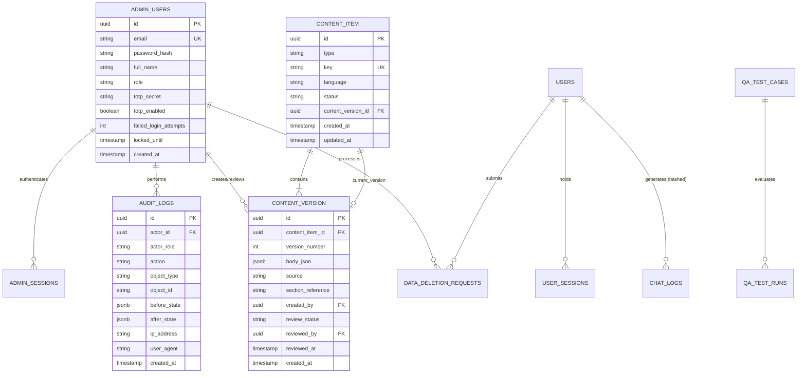

# LawGPT Data Model & Relational Schema Specification

**Document:** `/docs/admin/data-model.md`  
**Phase:** Phase 0 (Planning & Architecture)  
**Author:** Senior Full-Stack & Security Engineer  

---

## 1. Entity-Relationship Overview



---

## 2. Table Specifications

### 2.1. Administrative Authentication & Access Control

#### Table: `admin_users`
Stores administrative identities separate from mobile consumer user records.
```sql
CREATE TABLE admin_users (
    id TEXT PRIMARY KEY,                       -- UUID v4
    email TEXT UNIQUE NOT NULL,                -- Work email
    password_hash TEXT NOT NULL,               -- bcrypt (work factor 12) or argon2id
    full_name TEXT NOT NULL,
    role TEXT NOT NULL DEFAULT 'reviewer',     -- 'support' | 'reviewer' | 'subadmin' | 'admin'
    totp_secret TEXT,                          -- RFC 6238 Base32 secret (encrypted at rest)
    totp_enabled INTEGER NOT NULL DEFAULT 0,   -- 0: pending setup, 1: active
    failed_login_attempts INTEGER DEFAULT 0,   -- Count for lockout threshold (max 5)
    locked_until TEXT,                         -- ISO8601 timestamp for temporary lockout
    created_at TEXT NOT NULL,                  -- ISO8601
    updated_at TEXT NOT NULL                   -- ISO8601
);
```

#### Table: `admin_sessions`
Active administrative web sessions.
```sql
CREATE TABLE admin_sessions (
    id TEXT PRIMARY KEY,                       -- UUID v4
    admin_user_id TEXT NOT NULL REFERENCES admin_users(id) ON DELETE CASCADE,
    refresh_token_hash TEXT NOT NULL,          -- SHA-256 of opaque refresh token
    user_agent TEXT,
    ip_address TEXT,
    expires_at TEXT NOT NULL,
    revoked_at TEXT,                           -- Populated on logout or explicit revocation
    created_at TEXT NOT NULL
);
CREATE INDEX idx_admin_sessions_user ON admin_sessions(admin_user_id);
```

#### Table: `audit_logs` (Append-Only)
Immutable audit trail capturing all administrative mutations.
```sql
CREATE TABLE audit_logs (
    id TEXT PRIMARY KEY,                       -- UUID v4
    actor_id TEXT NOT NULL,                    -- Admin user ID or 'SYSTEM'
    actor_role TEXT NOT NULL,                  -- Snapshot of role at time of action
    action TEXT NOT NULL,                      -- e.g. 'users.suspend', 'content.publish'
    object_type TEXT NOT NULL,                 -- e.g. 'user', 'content_version', 'app_config'
    object_id TEXT NOT NULL,                   -- ID of targeted entity
    before_state TEXT,                         -- JSON snapshot before change (NULL on create)
    after_state TEXT,                          -- JSON snapshot after change (NULL on delete)
    ip_address TEXT,
    user_agent TEXT,
    created_at TEXT NOT NULL                   -- ISO8601
);
CREATE INDEX idx_audit_logs_actor ON audit_logs(actor_id);
CREATE INDEX idx_audit_logs_action ON audit_logs(action);
CREATE INDEX idx_audit_logs_created_at ON audit_logs(created_at);
```

---

### 2.2. User Management & Sessions

#### Table: `users`
Mobile citizen and advocate user records.
```sql
CREATE TABLE users (
    id TEXT PRIMARY KEY,                       -- UUID v4
    email TEXT UNIQUE NOT NULL,
    mobile TEXT UNIQUE NOT NULL,               -- +91 format
    full_name TEXT NOT NULL,
    role TEXT NOT NULL DEFAULT 'citizen',      -- 'citizen' | 'advocate'
    bar_council_number TEXT,
    free_quota_used INTEGER DEFAULT 0,         -- Count of free queries consumed
    is_suspended INTEGER DEFAULT 0,            -- 0: active, 1: suspended
    is_blocked INTEGER DEFAULT 0,              -- 0: active, 1: blocked
    suspension_reason TEXT,
    created_at TEXT NOT NULL,
    updated_at TEXT NOT NULL
);
CREATE INDEX idx_users_email ON users(email);
CREATE INDEX idx_users_mobile ON users(mobile);
```

#### Table: `user_sessions`
Active mobile app and device sessions.
```sql
CREATE TABLE user_sessions (
    id TEXT PRIMARY KEY,
    user_id TEXT NOT NULL REFERENCES users(id) ON DELETE CASCADE,
    device_id TEXT NOT NULL,                   -- Hardware UUID or installation ID
    device_name TEXT,                          -- e.g. "Pixel 8 Pro - Android 14"
    refresh_token_hash TEXT NOT NULL,
    ip_address TEXT,
    last_active_at TEXT NOT NULL,
    revoked_at TEXT,
    created_at TEXT NOT NULL
);
CREATE INDEX idx_user_sessions_user ON user_sessions(user_id);
```

---

### 2.3. Content Management & Four-Eyes Workflow

#### Table: `content_item`
Head reference for statutory content units.
```sql
CREATE TABLE content_item (
    id TEXT PRIMARY KEY,
    type TEXT NOT NULL,                        -- 'rights' | 'glossary' | 'ipc_bns_mapping' | 'document_template' | 'law_of_the_day' | 'fir_guide' | 'cyber_fraud_guide' | 'legal_aid_entry'
    key TEXT NOT NULL,                         -- Slug or statutory identifier, e.g. 'bns_103_murder'
    language TEXT NOT NULL DEFAULT 'en',       -- 'en' | 'hi' | 'mr'
    status TEXT NOT NULL DEFAULT 'draft',      -- 'draft' | 'in_review' | 'reviewed' | 'published' | 'archived'
    current_version_id TEXT,                   -- Pointer to active published content_version
    created_at TEXT NOT NULL,
    updated_at TEXT NOT NULL,
    UNIQUE(type, key, language)
);
CREATE INDEX idx_content_item_type_status ON content_item(type, status);
```

#### Table: `content_version`
Historical, immutable versions of a content unit.
```sql
CREATE TABLE content_version (
    id TEXT PRIMARY KEY,
    content_item_id TEXT NOT NULL REFERENCES content_item(id) ON DELETE CASCADE,
    version_number INTEGER NOT NULL,
    body_json TEXT NOT NULL,                   -- Canonical JSON payload conforming to schema
    source TEXT,                               -- Gazette reference or official source URL
    section_reference TEXT,                    -- e.g. "Section 103, Bharatiya Nyaya Sanhita 2023"
    created_by TEXT NOT NULL REFERENCES admin_users(id),
    review_status TEXT NOT NULL DEFAULT 'draft', -- 'draft' | 'in_review' | 'reviewed' | 'rejected'
    reviewed_by TEXT REFERENCES admin_users(id),
    review_notes TEXT,
    reviewed_at TEXT,
    created_at TEXT NOT NULL,
    UNIQUE(content_item_id, version_number)
);
CREATE INDEX idx_content_version_item ON content_version(content_item_id);
```

---

### 2.4. AI Observability, Evaluation & QA Benchmark

#### Table: `chat_logs`
Privacy-preserving log of AI interactions for safety monitoring.
```sql
CREATE TABLE chat_logs (
    id TEXT PRIMARY KEY,
    user_id_hash TEXT NOT NULL,                -- HMAC-SHA256 salted hash of user ID
    question TEXT NOT NULL,
    answer TEXT NOT NULL,
    citations_json TEXT NOT NULL,              -- JSON array of cited sections and case laws
    verified_flags INTEGER NOT NULL DEFAULT 0, -- 1 if all citations verified in gazette, 0 otherwise
    model TEXT NOT NULL,                       -- e.g. 'gemini-1.5-flash'
    prompt_version TEXT NOT NULL,              -- Version tag of active prompt
    latency_ms INTEGER NOT NULL,
    risk_level TEXT NOT NULL DEFAULT 'LOW',    -- 'LOW' | 'MEDIUM' | 'HIGH' | 'EMERGENCY'
    flags_json TEXT,                           -- JSON array: ['unverified_citation', 'user_thumbs_down', 'suicide_keyword']
    review_status TEXT DEFAULT 'pending',      -- 'pending' | 'approved' | 'corrected' | 'blocked' | 'in_test_set'
    reviewer_notes TEXT,
    reviewed_by TEXT REFERENCES admin_users(id),
    reviewed_at TEXT,
    created_at TEXT NOT NULL
);
CREATE INDEX idx_chat_logs_review_status ON chat_logs(review_status);
CREATE INDEX idx_chat_logs_created_at ON chat_logs(created_at);
```

#### Table: `qa_test_cases`
Benchmark questions from `/docs/qa-questions.json`.
```sql
CREATE TABLE qa_test_cases (
    id TEXT PRIMARY KEY,
    category TEXT NOT NULL,                    -- 'Criminal', 'Constitutional', 'Cyber', etc.
    question TEXT NOT NULL,
    expected_statute TEXT NOT NULL,            -- e.g. 'Section 103(1) BNS'
    critical_directive TEXT NOT NULL,
    risk_level TEXT NOT NULL DEFAULT 'LOW',
    last_run_answer TEXT,
    last_run_latency_ms INTEGER,
    last_run_citations TEXT,
    reviewer_verdict TEXT,                     -- 'VERIFIED_CORRECT' | 'MINOR_INACCURACY' | 'HALLUCINATION'
    reviewer_notes TEXT,
    score REAL,                                -- 0.0 to 100.0
    updated_at TEXT NOT NULL
);
```

---

### 2.5. Remote Configuration, Legal Directory & DPDP Erasure

#### Table: `app_config`
Dynamic runtime configuration with typed validation.
```sql
CREATE TABLE app_config (
    key TEXT PRIMARY KEY,
    value_json TEXT NOT NULL,                  -- Validated JSON string
    value_type TEXT NOT NULL,                  -- 'boolean' | 'string' | 'number' | 'object'
    description TEXT,
    is_public INTEGER NOT NULL DEFAULT 0,      -- 1: exposed on public /api/config, 0: internal
    updated_by TEXT NOT NULL REFERENCES admin_users(id),
    updated_at TEXT NOT NULL
);
```

#### Table: `emergency_directory`
Authoritative directory of DLSA, Women, Police, and Cyber Helplines.
```sql
CREATE TABLE emergency_directory (
    id TEXT PRIMARY KEY,
    name TEXT NOT NULL,
    number TEXT NOT NULL,
    category TEXT NOT NULL,                    -- 'police' | 'women' | 'cyber' | 'child' | 'legal_aid'
    state TEXT NOT NULL DEFAULT 'National',
    source_url TEXT NOT NULL,
    verified_on TEXT NOT NULL,                 -- Date contact was verified with authority
    is_active INTEGER NOT NULL DEFAULT 1,
    created_at TEXT NOT NULL,
    updated_at TEXT NOT NULL
);
```

#### Table: `data_deletion_requests`
Statutory compliance queue under Digital Personal Data Protection (DPDP) Act 2023.
```sql
CREATE TABLE data_deletion_requests (
    id TEXT PRIMARY KEY,
    user_id TEXT NOT NULL REFERENCES users(id) ON DELETE CASCADE,
    user_identifier TEXT NOT NULL,             -- Snapshot of email/mobile
    status TEXT NOT NULL DEFAULT 'pending',    -- 'pending' | 'in_progress' | 'completed' | 'rejected'
    sla_due_date TEXT NOT NULL,                -- 30 days statutory timeline
    completed_at TEXT,
    completed_by TEXT REFERENCES admin_users(id),
    rejection_reason TEXT,
    created_at TEXT NOT NULL
);
CREATE INDEX idx_deletion_requests_status ON data_deletion_requests(status);
```

---

## 3. Data Integrity & Business Rule Enforcement

1. **Four-Eyes Enforcement:**
   A trigger or service constraint verifies that when a `content_version` status is updated to `'published'`, `content_version.created_by != current_admin_user_id`.
2. **Last Admin Protection:**
   A trigger/constraint prohibits updating `role != 'admin'` or deleting an admin user when `SELECT COUNT(*) FROM admin_users WHERE role = 'admin'` equals 1.
3. **Audit Log Immutability:**
   Database table permissions or application middleware enforce `INSERT` and `SELECT` only on `audit_logs`. `UPDATE` and `DELETE` queries are prohibited.
