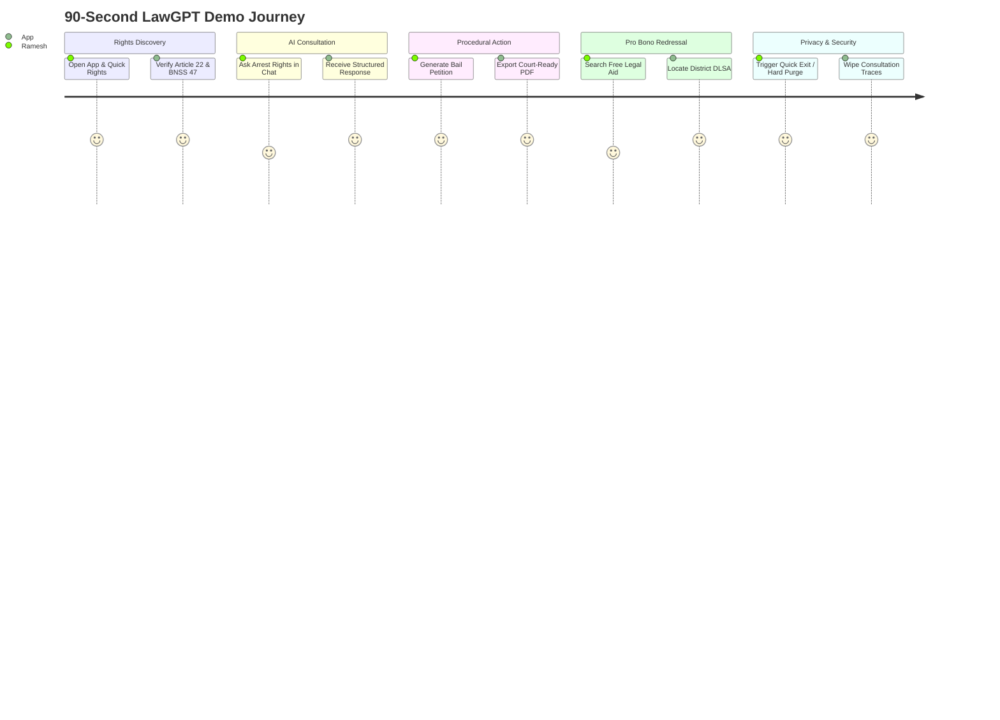

# LawGPT Mobile – 90-Second Reviewer Walkthrough Script

**Persona:** Ramesh (a 28-year-old shopkeeper falsely detained by local police without an arrest warrant)  
**Total Duration:** 90 Seconds  
**Objective:** Demonstrate end-to-end user journey across rights awareness, AI consultation, petition drafting, pro bono legal aid, and privacy preservation.

---

## Timeline & Step-by-Step Script

### 00:00 – 00:15 | Step 1: Instant Emergency Rights Check
- **Action:** Launch the LawGPT App on phone.
- **Screen:** `SplashScreen` → `HomeScreen`.
- **Tap:** Tap the red **"Emergency SOS / Quick Rights"** button at the top header or quick action card.
- **Expected UI Response:**
  - `QuickRightsModal` pops up instantly.
  - Displays **"Your 5 Immutable Constitutional Arrest Rights"**:
    1. Right to Know Grounds (Section 47 BNSS)
    2. Mandatory Arrest Memo signed by witness
    3. Production before Magistrate within 24 Hours (Article 22(2))
    4. Statutory Medical Examination (Section 53 BNSS)
    5. No arrest of women after sunset without judicial sanction.
  - Verification badge shows: `Statutory Emerald • Verified from Official Gazette`.

### 00:15 – 00:35 | Step 2: In-Depth AI Consultation with Section Verification
- **Action:** Tap **"Ask LawGPT for Details"** or navigate to the `ChatScreen`.
- **Query:** Send question: *"What are my rights if I am arrested without a warrant?"*
- **Expected UI Response:**
  - Streaming typing indicator synthesizes statutory guidance.
  - Returns `StructuredAnswerCard` containing:
    - **Executive Summary:** Clear statement on Article 22 & BNSS 2023.
    - **Relevant Law:** Section 47 & 50 BNSS 2023 with green `Verified Source` seal.
    - **What You Can Do:** Step 1 (Arrest Memo) & Step 2 (Medical Examination).
    - **Landmark Citation:** *D.K. Basu v. State of West Bengal* (AIR 1997 SC 610).
    - **Statutory Disclaimer:** Clearly states guidance does not substitute an advocate.
- **Toggle:** Tap **"Plain Explanation (सरल)"** pill to show simplified vernacular language without jargon.

### 00:35 – 00:55 | Step 3: Drafting a Bail Petition in Under 30 Seconds
- **Action:** Navigate to **Legal Tools** tab (`ToolsScreen`) and tap **"Legal Documents"**.
- **Screen:** `LegalDocumentsScreen`.
- **Tap:** Select **"Bail Application (Sec 482 BNSS / 437 CrPC)"**.
- **Action:** Dynamic form builder opens. Enter applicant name (*"Ramesh Sharma"*), Police Station (*"Andheri West"*), and FIR/Bail grounds.
- **Tap:** Tap **"Generate Court Draft & Preview"**.
- **Expected UI Response:**
  - A4 Court-formatted petition renders instantly with a diagonal `"DRAFT"` watermark.
  - Features state stamp duty caution banner: *"Draft – review before filing in court."*
  - Tap **"Export & Share PDF"** to trigger native `expo-print` and `expo-sharing` dialog. Devanagari font embeds cleanly with zero missing glyphs.

### 00:55 – 01:15 | Step 4: Finding Pro Bono Representation
- **Action:** Return to `ToolsScreen` and tap **"Free Legal Aid (NALSA / DLSA)"**.
- **Screen:** `LegalAidScreen`.
- **Filter:** Type *"Mumbai"* or select State *"Maharashtra"*.
- **Expected UI Response:**
  - Card displays **Mumbai Suburban DLSA** (Bandra Court Complex) and National Legal Aid Helpline **15100**.
  - Shows verified operational hours, contact phone numbers, and eligibility criteria under Legal Services Authorities Act, 1987.
  - Notice alert confirms verified status within 90 days.

### 01:15 – 01:30 | Step 5: Privacy, Quick Exit & Data Purge
- **Action:** Return to `ChatScreen`.
- **Tap:** Tap **"Quick Exit (Clear screen)"** pill in the composer.
- **Expected UI Response:** The active consultation is wiped from display immediately.
- **Final Action:** Open **Profile & Security** (`ProfileScreen`).
- **Tap:** Tap **"Delete All My Data"** under DPDP Act 2023 Compliance.
- **Confirm:** Tap "Delete Everything" on the destructive confirmation dialog.
- **Expected UI Response:**
  - Hardware Keystore tokens and local AsyncStorage are hard-purged.
  - User session resets cleanly to the introductory Welcome screen.

---

## Reviewer Verification Checklist
- [x] Zero network drop issues; offline handbooks accessible anytime.
- [x] Clear statutory citations (*D.K. Basu*, BNSS 47, Article 22).
- [x] Honest verification seals—only verified laws display green seals.
- [x] Complete compliance with DPDP Act 2023 data disposal standards.
